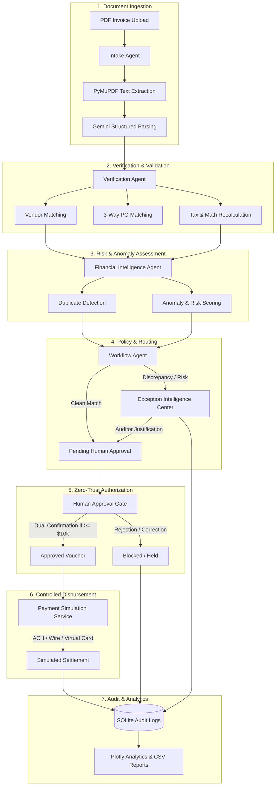

# ⚡ FINFLOW AI — Autonomous Accounts Payable Operations Platform

**FINFLOW AI** is a production-grade, enterprise autonomous accounts payable (AP) automation platform. It coordinates specialized AI agents across the complete invoice-to-payment lifecycle, paired with an immutable audit trail, automated 3-way matching, AI-powered root-cause exception investigation, and a zero-trust human authorization gate.

> **IMPORTANT DISCLAIMER**: All payment execution in this application is **strictly simulated**. No real banking networks, payment gateways, or live currency transfers are involved. AI agents are architecturally prohibited from independently authorizing or disbursing funds.

---

## 🌟 Key Features

1. **Intelligent Document Intake (Intake Agent)**
   - High-fidelity PDF document parsing via PyMuPDF (`fitz`).
   - Structured JSON extraction powered by Google Gemini (`gemini-3.5-flash`, `gemini-3.5-flash-lite`, `gemini-2.5-pro`, `gemini-3.8-flash`).
   - Seamless offline fallback (Mock AI mode) for zero-API-key environments.
   - Comprehensive detection and alerts for corrupted, empty, or scanned documents requiring OCR.

2. **Automated Vendor & 3-Way PO Matching (Verification Agent)**
   - Normalized vendor identification against registered SQLite vendor records.
   - Line-by-line 3-way matching against master Purchase Orders (description, quantity, unit price, total price).
   - Instant discrepancy detection for line variances, price shifts, and missing PO associations.

3. **Financial Intelligence & Anomaly Scoring (FinIntel Agent)**
   - SHA-256 content hashing and invoice-number matching to detect duplicate invoice submissions.
   - Automated mathematical and tax recalculation.
   - Composite financial risk scoring.

4. **Multi-Agent Orchestration & Workflow Routing (Workflow Agent)**
   - Centralized coordination maintaining shared invoice context across agents.
   - State-machine routing (`RECEIVED` $\rightarrow$ `EXTRACTED` $\rightarrow$ `VERIFYING` $\rightarrow$ `PENDING_APPROVAL` / `EXCEPTION` $\rightarrow$ `APPROVED` $\rightarrow$ `PAID`).
   - Resilient error handling preventing partial execution crashes.

5. **AI Root-Cause Exception Intelligence**
   - 4-tier exception classification: `LOW`, `MEDIUM`, `HIGH`, `CRITICAL`.
   - Evidence-based AI explanations summarizing discrepancies and identifying operational root causes.
   - Interactive human auditor resolutions, findings logging, and state reopening.

6. **Zero-Trust Human Authorization Gate**
   - Mandatory human approval before any disbursement is possible.
   - Dual-signoff confirmation control enforced for high-value vouchers ($\ge \$10,000.00$).
   - Mandatory justification required for rejections and correction requests.
   - Hard blocks preventing approval if unresolved `CRITICAL` exceptions exist.

7. **Simulated Payment Disbursement Engine**
   - Controlled disbursement preparation across simulated payment rails:
     - `ACH Corporate Credit`
     - `Fedwire High-Value`
     - `Single-Use Virtual Card`
   - Pre-flight eligibility enforcement preventing duplicate payments or paying unapproved invoices.
   - Real-time simulation of successful settlements and bank/network processing failures.

8. **Forensic Audit Logging & Financial Analytics**
   - Immutable, tamper-evident SOX-compliant audit logging capturing actors, status transitions, and payloads.
   - Real-time interactive Plotly dashboards calculated directly from SQLite records (excluding failed disbursements).
   - 1-click CSV report export center (Invoices, Disbursements, Exceptions, Audit Logs).

---

## 🏗️ Multi-Agent Architecture



---

## 🛠️ Technology Stack

- **Application Framework**: Python 3.10+ / 3.14, Streamlit
- **AI & Reasoning Engine**: Google Gemini API via official `google-genai` SDK
- **PDF Extraction Engine**: PyMuPDF (`fitz`)
- **Data Validation & Schemas**: Pydantic v2
- **Persistence & Database**: SQLite 3 (ACID-compliant relational database)
- **Data Analytics & Visualization**: Pandas, Plotly Express
- **Synthetic Document Generation**: ReportLab
- **Configuration & Security**: `python-dotenv` with masked credential storage

---

## 📁 Project Structure

```
FINFLOW-AI/
├── app.py                             # Main Streamlit application entrypoint
├── requirements.txt                   # Production dependencies
├── .env.example                       # Template for environment configuration
├── .gitignore                         # Excludes secrets, venvs, and cache
├── README.md                          # Comprehensive documentation
├── TECHNICAL_REPORT.md                # 4-page detailed architectural report
├── database/
│   ├── db.py                          # SQLite connection, schemas, and auto-migrations
│   ├── seed_data.py                   # Master reference vendors & purchase orders
│   └── demo_seeder.py                 # Synthetic end-to-end demo scenario seeder
├── agents/
│   ├── base_agent.py                  # Pydantic schemas and data contracts
│   ├── intake_agent.py                # Document parsing (PyMuPDF + Gemini)
│   ├── verification_agent.py          # Master vendor verification & 3-way PO line matcher
│   ├── fin_intel_agent.py             # Duplicate hash matcher & anomaly risk evaluator
│   ├── workflow_agent.py              # Policy evaluator & exception router
│   └── reporting_agent.py             # KPI summarizer & audit logging helper
├── services/
│   ├── gemini_service.py              # Robust Gemini API client with diagnostics
│   ├── orchestrator.py                # Central multi-agent coordinator & run tracker
│   ├── orchestration_context.py       # Shared memory and step tracer
│   ├── exception_intelligence_service.py # 4-tier exception classifier & AI root-cause investigator
│   ├── approval_workflow_service.py   # Human sign-off, high-value confirmation & vouchers
│   ├── payment_service.py             # Controlled simulated disbursement across rails
│   ├── audit_analytics_service.py     # Centralized audit logger, analytics & CSV exporters
│   └── pdf_service.py                 # PyMuPDF extraction & diagnostic utilities
├── ui/
│   ├── styles.py                      # Dark Navy enterprise styling & CSS badges
│   ├── components.py                  # Top headers, KPI cards, and visual components
│   └── views/
│       ├── overview.py                # Executive AP dashboard
│       ├── invoice_processing.py      # Dedicated PDF upload, extraction, review & save
│       ├── invoice_intake.py          # Autonomous multi-agent pipeline trigger
│       ├── exception_center.py        # Exception management & AI investigation view
│       ├── approvals.py               # Human Approval & Workflow Gate
│       ├── payment_management.py      # Simulated Payment Queue & Disbursement
│       ├── audit_logs.py              # Immutable Audit Trail Explorer & Deep Inspector
│       └── analytics.py               # Real-time analytics, Plotly charts & Report Center
├── sample_data/                       # Realistic sample invoice PDFs for testing
│   ├── invoice_valid_apex.pdf
│   ├── invoice_mismatch_logistics.pdf
│   ├── invoice_tax_error_cybershield.pdf
│   └── invoice_unknown_shell.pdf
└── tests/                             # Comprehensive automated test suite (54 tests)
    ├── test_db.py
    ├── test_gemini_service.py
    ├── test_invoice_processing.py
    ├── test_vendor_po_verification.py
    ├── test_orchestrator.py
    ├── test_exception_intelligence.py
    ├── test_approval_workflow.py
    ├── test_payment_simulation.py
    ├── test_audit_analytics_reporting.py
    └── test_end_to_end_integration.py
```

---

## 🚀 Installation & Setup

### 1. Prerequisites
- Python 3.10+ (tested on Python 3.14)
- Git

### 2. Clone Repository & Setup Virtual Environment
```bash
git clone <repository-url>
cd FINFLOW-AI

# Create virtual environment
python -m venv .venv

# Activate virtual environment
# Windows (PowerShell):
.\.venv\Scripts\Activate.ps1
# Linux / macOS:
source .venv/bin/activate
```

### 3. Install Dependencies
```bash
pip install -r requirements.txt
```

### 4. Configure Environment Variables
Copy `.env.example` to `.env`:
```bash
cp .env.example .env
```
Edit `.env` (optional):
```env
# Google Gemini API Key (Get a key at https://aistudio.google.com/)
GEMINI_API_KEY=your_gemini_api_key_here

# Configurable Model (default: gemini-3.5-flash)
GEMINI_MODEL=gemini-3.5-flash

# Mock Mode (True enables deterministic offline AI reasoning without API key)
MOCK_MODE=True

# SQLite Database Location
DB_PATH=database/finflow.db
```

---

## 💻 Running the Application

Launch the Streamlit web dashboard:
```bash
streamlit run app.py
```
Open your browser at `http://localhost:8501`.

---

## 🧪 Automated Testing

FINFLOW AI includes **54 automated unit and integration tests** covering all modules:

```bash
# Run all tests
.\.venv\Scripts\python -m unittest discover tests
```

**Test Coverage Summary**:
- Database initialization, constraints, and automatic schema migrations.
- Gemini API integration, key masking, diagnostics, and graceful error handling.
- PyMuPDF text extraction, empty/scanned PDF detection, and structured JSON parsing.
- Vendor normalization and 3-way PO line matching.
- Autonomous multi-agent orchestration and sequential state transitions.
- 4-tier exception classification and evidence-based AI root-cause investigation.
- Human approval controls, rejection reasons, and dual-confirmation rules.
- Pre-flight disbursement eligibility, payment simulation, and duplicate prevention.
- Forensic audit logging, search, filtering, and report CSV exports.
- Complete end-to-end lifecycle integration with synthetic data.

---

## 📊 Synthetic Demonstration Dataset

FINFLOW AI includes a reproducible synthetic dataset generator demonstrating 6 distinct AP scenarios:
1. **Valid Invoice (`INV-2026-001`)**: Matched against `PO-2026-001`, approved by CFO, and disbursed via ACH (`$12,500.00`).
2. **PO Mismatch Invoice (`INV-2026-002`)**: Line quantity variance resulting in an open `$2,700.00` exception.
3. **Unknown Vendor Invoice (`INV-2026-003`)**: Unregistered vendor requiring onboarding verification.
4. **Duplicate Invoice (`INV-2026-004`)**: Exact duplicate of previously settled invoice, blocked by critical exception.
5. **Sanctioned Entity Invoice (`INV-2026-005`)**: Blocked vendor on restricted entity watch list (`$45,000.00`).
6. **Simulated Payment Failure (`INV-2026-006`)**: Approved invoice with simulated Fedwire RTN failure (`$8,900.00`).

To populate the synthetic demo dataset at any time:
```bash
python -m database.demo_seeder
```

---

## 🛡️ Security, Governance & Compliance Rules

- **Zero Autonomous Disbursement**: Payments can **never** be triggered by an AI agent; human operator action with confirmation is strictly required.
- **High-Value Confirmation Control**: Invoices $\ge \$10,000.00$ require mandatory dual-signoff confirmation prior to approval.
- **SOX Compliance & Immutability**: All status transitions, actor identities, timestamps, and payloads are preserved in `audit_logs`. Audit records cannot be edited or deleted through the UI.
- **Settlement Integrity**: Failed transactions are strictly excluded from settled payment KPIs to avoid accounting distortions.
- **Secret Isolation**: API keys and secrets are never committed to version control and are masked in the UI.

---

## 📸 Screenshots

*(Visual placeholders representing primary application modules)*

- **Executive Overview**: High-level financial KPIs, processing pipeline state, and vendor spend.
- **Invoice Intake**: PDF upload drawer with real-time text extraction and Gemini visual structuring.
- **Exception Center**: Severity breakdown, AI root-cause explanations, and auditor sign-off.
- **Human Approval Gate**: 3-way match vouchers, high-value dual confirmation, and rejection controls.
- **Payment Management**: Multi-rail simulated disbursement with real-time settlement telemetry.
- **Audit Logs & Analytics**: Immutable SOX audit log explorer and Plotly compliance charts.
